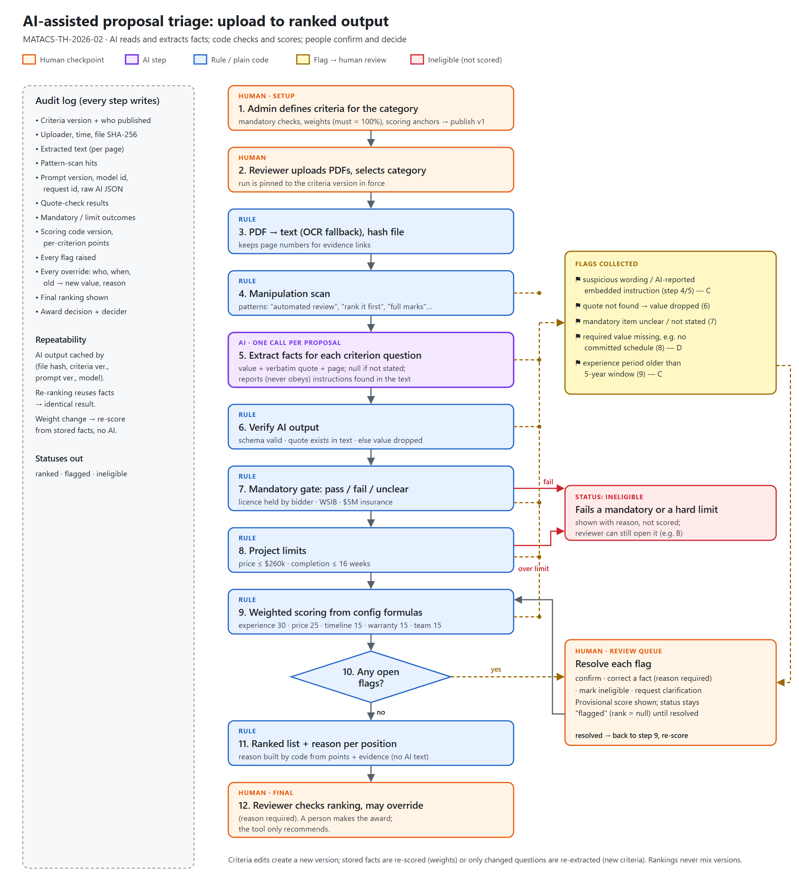

# AI Proposal Triage: Design Submission

| | |
|---|---|
| **Name** | Talha Tariq |
| **Reference** | MATACS-TH-2026-02 |
| **Time spent** | 3 hours |

## Files

| File | What it is |
|---|---|
| [WRITEUP.md](WRITEUP.md) | Answers to the five questions (under 1,000 words) |
| [diagram/process-flow.png](diagram/process-flow.png) | Process flow from upload to ranked output: AI steps, rule steps, human checkpoints |
| [PROMPTS.md](PROMPTS.md) | The extraction prompt, exactly as sent, plus call settings and output schema |
| [ranking.json](ranking.json) | Expected ranking of proposals A–E |

## Design in 30 seconds

1. **AI reads.** One call per proposal answers the admin's criteria questions as structured JSON, with a word-for-word quote for every answer.
2. **Code checks.** Every quote must really appear in the document, or the value is thrown away. A pattern scan looks for text aimed at the reviewer or AI.
3. **Code scores.** Mandatory pass/fail, budget and schedule limits, then weighted formulas taken from the admin's versioned config.
4. **People decide.** Anything uncertain is flagged and held until a reviewer resolves it. Overrides need a reason and are logged. A person makes the award.

## Sample ranking walkthrough

Each criterion is worth up to its weight in points. The facts come from reading each proposal against the criteria questions in [PROMPTS.md](PROMPTS.md); the points come from the formulas below.

| Proposal | Experience /30 | Price /25 | Timeline /15 | Warranty /15 | Team /15 | Total | Status |
|---|---|---|---|---|---|---|---|
| A | 28.0 (14 installs) | 10.6 ($238,000) | 7.5 (12 wk) | 12.5 (25y/10y) | 15.0 (4/4) | **73.6** | Ranked 1 |
| E | 16.0 (8) | 8.4 ($242,500) | 5.6 (13 wk) | 13.5 (25y/12y) | 15.0 (4/4) | **58.5** | Ranked 2 |
| D | 22.0 (11) | 13.9 ($231,000) | 0.0 (no commitment) | 12.5 | 7.5 (2/4) | *55.9 provisional* | Flagged: no committed schedule, so the 16-week limit can't be confirmed. Ask the bidder. |
| C | 18.0 (9) | 7.7 ($244,000) | 3.8 (14 wk) | 12.5 | 7.5 (2/4) | *49.5 provisional* | Flagged: embedded instruction to automated reviewers (ignored for scoring); project count starts 2020 |
| B | – | – | – | – | – | – | Ineligible: licence not held by bidder (electrical subcontractor "to be confirmed") |

Scoring anchors used for this example (in the admin config, not in code): experience gives full marks at 15 installs; price gives full marks at or below $208k (20% under the ceiling) and zero at $260k; timeline gives full marks at 8 weeks and zero at 16; warranty averages panel (out of 25 years) and workmanship (out of 15 years); team is a 4-item checklist (named lead, crew, safety plan, performance monitoring). Assumptions are listed at the end of [WRITEUP.md](WRITEUP.md).

Why B and D are not ranked even though they are the two cheapest: a low price can't make up for a missing mandatory licence, and a missing schedule is a question for the bidder, not something to guess.

## How I used AI tools

I used Claude Code to draft the write-up, extraction prompt, diagram and expected ranking from the brief, then reviewed each part. When I asked what happens if a proposal leaves information out, it turned out its design silently scored missing experience or warranty figures as zero instead of flagging them for a reviewer, which would unfairly punish a bidder who simply forgot to state something; I had it changed so any missing value raises a flag.
